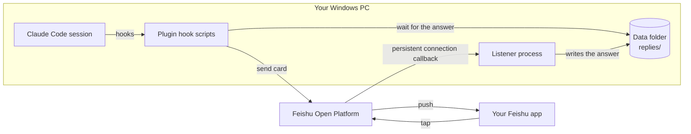

**English** | [中文](README.md)

# claude-feishu-remote

**Approve Claude Code permission prompts and answer its questions from Feishu, and watch and steer running sessions.** When you are away from your PC, everything Claude Code is waiting on you for is pushed to Feishu as a card. Tap the card and Claude carries on right away. You can also see what a session is doing, get a notice when a long task ends, stop a turn that went the wrong way, and send a session instructions at any time.

> Works with **Feishu (飞书, the China edition)** on **Windows**. Lark international tenants (open.larksuite.com) are not supported yet: the endpoints are Feishu's.

## What it does

| In Claude Code | In Feishu | What you can do |
|---|---|---|
| Permission prompt (run a command, edit a file, call a tool…) | Approval card with the tool and its full parameters | Allow / Always allow this kind in this session / Deny / Deny with a note |
| Question dialog (AskUserQuestion) | Question card: buttons for a single-choice question, a form for several questions or multiple choice | Pick an option, or type your own answer |
| A blocking question in the desktop app's "next step" box | Turned into a question card (see "How it works") | Same as above |
| Claude wants to open a sub-session in the desktop app | The "new session or do it here" question is turned into a question card; a sub-session Claude proposes on its own gets a notice; when the call needs approval, a "sub-session request" card that says what allowing leads to | Answer the question card, allow or deny; a proposed sub-session can be started with "直接开始" (start now), or allowed and then started at the computer |
| A plan waiting for approval, an MCP server asking for input, a session error | Text notification | Handle it at the computer |
| You send 会话 ("sessions") to the bot in Feishu | The active sessions: status, project, model, last activity, cards still waiting for you, and a text box under each | Send a session an instruction; 查看 (view) what it is doing; 停止这一轮 (stop this turn); 设为当前会话 (make it the current session) |
| You tap 查看 on the session list | Session detail card: this turn's prompt and running time, the tool call in progress, recent steps, task list, Claude's latest words, model, permission mode, context use | Refresh, page back through the steps, read the latest words in full, follow, stop |
| A turn ran longer than 5 minutes (adjustable), or any turn of a session you follow ended | A completion notice with the turn's last reply, in pages when it is long | Page through it; reply to it to send the session a new instruction |
| You "reply" in the chat to any message or card a session sent | A receipt naming the session it went to | The text goes to that session as an instruction |

- If you answer on the computer first, the Feishu card switches to "handled on the computer", so nothing is answered twice.
- A card waits up to 12 hours for you. After that it is closed and you handle the prompt at the computer.
- Only the one Feishu account you bind can answer. Clicks and commands from anyone else are refused.
- Approval cards show the full parameters. When they are too long to show in full, the card offers neither Allow nor Always allow, so you never approve something you could not read.
- "Always allow this kind in this session" uses only the rule Claude Code itself suggests, and always adds it to this session only (never to a settings file; it ends with the session). The card spells out the exact rule, for example `Bash(npm test:*)`.
- Until it is set up, the plugin does nothing: installed without running the setup script, Claude Code behaves exactly as without it.
- The card buttons and messages are in Chinese.

## How it works



- **Hooks**: the plugin hooks into Claude Code's `PermissionRequest`, `PreToolUse`, `Notification` and other events. When your answer is needed, a hook sends a Feishu card and waits.
- **Listener**: a small background process receives card taps over Feishu's persistent connection (long connection) and hands each answer to the waiting hook. A Windows scheduled task starts it at logon and checks it every 5 minutes, so it recovers by itself. No public server and no open ports are needed.
- **How answers reach Claude**: Allow / Deny and question answers go back through the hooks' standard return values, i.e. Claude Code's own answer channel, exactly as if you had clicked on the computer. Claude therefore treats your Feishu answer as your own input and acts on it.
- **How stop and mid-turn instructions take effect**: the plugin has a hook before every tool call (about 70 ms each when there is nothing to do, mostly Python start-up). After you tap stop, this hook ends the turn at the session's next tool call, before the tool runs; an instruction you send to a busy session is handed to Claude at its next tool call. Both therefore act only between tool calls: while Claude writes a long text or waits for a subagent, they wait for its next tool call, at the latest the end of the turn.
- **Why plans cannot be approved in Feishu**: measured, the desktop app's plan approval does not accept a decision from a hook, so a plan waiting for approval gets a text notification and is approved at the computer.
- **Why the "next step" box is turned into a question dialog**: an outside program can only deliver an answer to the "next step" box as a background notification, which Claude Code marks as "not user input, not an approval". That is a deliberate anti-spoofing safeguard and cannot be worked around. So the plugin stops a blocking "next step" box that carries a question and has Claude ask the same question with AskUserQuestion instead, where your Feishu answer counts. The plugin also tells Claude this rule at the start of every session.
- **Why a proposed sub-session is started at the computer**: the desktop app opens sub-sessions through cards of its own, which a hook cannot click. The "new session / do it here" card keeps its turn waiting, so while reminders are on the plugin stops it and has Claude ask with AskUserQuestion instead (with reminders off you are at the computer, and the card shows as usual). A sub-session Claude proposes on its own does not hold the session up, so the plugin only sends a notice that a "new task" card is waiting at the computer for you to start it. Measured: in a turn started by a Feishu instruction, the desktop app itself does not let Claude open a sub-session directly, it can only propose one; and a hook cannot turn a proposal into a start (allowing it with changed parameters makes the call fail). When Claude opens a sub-session at your request rather than proposing one, tapping Allow on its approval card starts it. So the approval card of a proposal has a "直接开始" (start now) button: tapping it sends the proposal back, Claude asks again as a start at your request, and one more tap on Allow starts the sub-session without going to the computer. It works only in a turn you began at the computer; when the desktop app refuses, Claude proposes again, and for 10 minutes that card does not offer the button a second time.

## Before you start

- **Windows 10/11 and Feishu (China edition) only**; Lark international is not supported yet.
- **Each computer needs its own Feishu app.** Feishu's persistent connection does not broadcast: when two computers connect with the same app, each tap goes to one of them at random. Two computers of the same person also need two apps.
- **Security**: whoever controls the Feishu account you bind can approve actions on this computer from Feishu, and send instructions to running sessions or stop them. In a session that skips permission prompts or runs in auto mode, what a Feishu instruction leads to runs without an approval card too. Bind only your own account and make the app available only to yourself. Credentials are stored only on this computer, in `%LOCALAPPDATA%\FeishuRemote\config.json`.
- **Session content goes to Feishu**: the session detail card and completion notices send this turn's prompt, the commands run and Claude's reply to your Feishu chat (to the bound account only). A secret in a command or a reply shows up in Feishu too. A turn longer than 5 minutes sends a completion notice by default; send 通知 关 ("notify off") to the bot to stop that. The full reply is kept in the local data folder for 7 days, for the page buttons.
- Anything you could not have Claude do by saying it on the computer (for example typing a password for you), you cannot have it do through Feishu either.

## Installation

### 1. Prerequisites

- Claude Code (desktop or CLI), with the `claude` command available in a terminal.
- Python 3.10 or newer from <https://www.python.org>, with "Add python.exe to PATH" ticked. `python --version` in a new PowerShell window should print the version.

### 2. Create an app on the Feishu Open Platform

Open <https://open.feishu.cn/app>:

1. **Create a custom app** (企业自建应用) with any name, for example "My Claude assistant".
2. **Add the Bot capability** (添加应用能力 → 机器人).
3. Under **Permissions** (权限管理), enable these three scopes:
   - `im:message:send_as_bot`: send messages as the app
   - `im:message:update`: update messages (cards are marked as handled after you answer)
   - `im:message.p2p_msg:readonly`: read the private messages users send to the bot (for binding your account and for commands such as 会话)
4. **Create a version and publish it** (版本管理与发布 → 创建版本). Set the availability (可用范围) to yourself only. If your organisation requires admin review, wait for the approval. Keep the availability to yourself: anyone who can chat with the bot could send wrong codes while you bind and void your code.
5. Note the **App ID** and **App Secret** under Credentials & Basic Info (凭证与基础信息); you need them in step 4.

Leave "Events & Callbacks" (事件与回调) for now: Feishu only saves a persistent-connection subscription while the listener on your computer is online, and the setup script tells you when.

### 3. Install the plugin

In a terminal:

```powershell
claude plugin marketplace add zhishouhuameiwan/claude-feishu-remote
claude plugin install feishu-remote@claude-feishu-remote
```

If the first command hangs, see "Troubleshooting" below. Without access to GitHub, download the repository, unzip it to a permanent folder (the plugin runs from that folder, so do not delete it later) and use the folder path instead of `zhishouhuameiwan/claude-feishu-remote`.

### 4. Run the setup script

In PowerShell (no administrator rights needed):

```powershell
$list = (claude plugin list --json | Out-String) | ConvertFrom-Json
$plugin = @($list) | Where-Object { $_.id -eq 'feishu-remote@claude-feishu-remote' } | Select-Object -First 1
$dir = if ($plugin.readFromFolder) { $plugin.readFromFolder } else { $plugin.installPath }
powershell -ExecutionPolicy Bypass -File (Join-Path $dir 'setup.ps1')
```

These lines find the plugin folder (`$dir`); "the plugin folder" below, for `uninstall.ps1` and `notify_switch.py`, means this folder. For a local download it is `<folder>\plugins\feishu-remote`.

The script:

1. **Checks Python.**
2. **Prepares the listener's environment**: a separate Python environment in `%LOCALAPPDATA%\FeishuRemote` with lark-oapi installed and preloaded. The first preload can take a minute or two.
3. **Asks for the credentials**: App ID and App Secret, which it checks with Feishu before saving. The secret is not shown while you type and never appears on a command line.
4. **Starts the listener**: registers the scheduled task "Feishu Remote Listener", which starts at logon and is checked every 5 minutes.
5. **Pauses while you configure "Events & Callbacks" in the Feishu console**:
   - Event configuration (事件配置): choose "receive events through persistent connection" (使用长连接接收事件) and add the event `im.message.receive_v1`.
   - Callback configuration (回调配置): choose "receive callbacks through persistent connection" (使用长连接接收回调) and add the callback `card.action.trigger`.
   - Create and publish a new version. Every change to scopes or subscriptions needs a new published version.

   Then press Enter in PowerShell.
6. **Binds your account**: the script shows an 8-digit code. Open the private chat with your bot in Feishu and send the code as it is. When you see the success message, you are done; Feishu also gets a confirmation message.

### 5. Start using it

Open a new Claude Code session. Sessions that were already open, including those opened before binding, need to be reopened. From then on, Claude's approvals and questions arrive in Feishu as cards.

## Everyday use

- **See the active sessions and send them instructions**: send 会话 to the bot in Feishu to get a card with the active sessions.
  - Active means working, waiting for you (a permission prompt, a question or an open card), or idle but still able to take an instruction (its last turn ended less than 12 hours ago). Other idle sessions are only counted at the bottom.
  - Sessions waiting for you come first; one card lists at most 10 (the rest, the least urgent, are only counted). Each shows its project, current model, last activity, Feishu cards still waiting for your answer, and queued instructions.
  - Each session has a text box: type an instruction and tap 发送 (send). An idle session starts on it right away; a working session gets it at its next tool call (mid-turn), at the latest when the turn ends. When it is done, Claude's last reply is sent back to Feishu.
  - The instruction reaches the session as a notification, which Claude Code does not count as your own input (like replies to the "next step" box; this protection cannot be bypassed). So Claude does what needs no approval right away, and for anything that needs your decision (commit, push, delete) it first sends a question card that you answer in Feishu.
  - Only text instructions work: slash commands such as `/compact` or `/model` do not. Only sessions opened after installing 1.1.0 can take instructions; stop and mid-turn instructions need sessions opened after installing 1.2.0; the notice for a proposed sub-session and the "new session or do it here" question card need sessions opened after installing 1.3.0.
  - After a turn interrupted with Esc or ended by an API error, a session takes instructions again once its next turn ends (instructions sent meanwhile are queued). A turn stopped from Feishu is different: the session takes instructions right after it stops. An instruction still queued after 12 hours is dropped.
  - The list comes from Claude Code's own `claude agents --json`, so the listener must be able to run `claude`. Send 帮助 ("help") for all commands.
- **See what a session is doing**: tap 查看 on the session list for the session detail card (see the table above). 刷新 refreshes it, 更早的步骤 pages back. After 关注 (follow), every turn of that session sends its last reply; for other sessions only turns longer than 5 minutes do. Send 通知 10 to the bot to make that 10 minutes, 通知 关 to turn it off, 通知 to see the setting. Long replies come in pages: tap 下一页 (next page).
- **Stop a running turn**: tap 停止这一轮 on the session list or the detail card. The session stops at its next tool call and Feishu gets a "stopped" notice. If it is waiting on an approval or a question, that card is answered "stop" and Claude is told to end the turn. Only this turn stops: new instructions from the computer or from Feishu are handled as usual afterwards. Stop does nothing on a session that is already idle, and a stop that no tool call and no turn end reached within 30 minutes lapses.
- **Send a session instructions straight from the chat**:
  - "Reply" to any message or card a session sent (approval cards, completion notices, detail cards, receipts): the reply goes to that session. Even a command word such as 会话 in a reply is an instruction for the session.
  - Or tap 设为当前会话 (make it the current session) on the session list or a detail card: plain text you type in the chat then goes to that session. It is cleared after 30 minutes without use, and every message gets a receipt naming the session. The command words 会话, 帮助 and 通知 stay commands.
- **Pause notifications**: `python <plugin folder>\scripts\notify_switch.py off`; use `on` to resume. Commands you send still get an answer while notifications are paused.
- **Receive on another Feishu account**: run `setup.ps1 -Rebind`.
- **Switch to another Feishu app**: run `setup.ps1 -Reconfigure`. The old binding is cleared automatically; bind again.
- Install only one copy per computer. Do not also load a copy with `--plugin-dir`: two copies make the listener restart back and forth.

## Updating

```powershell
claude plugin marketplace update claude-feishu-remote
claude plugin update feishu-remote@claude-feishu-remote
```

Then run `setup.ps1` again as in installation step 4: it updates lark-oapi and restarts the listener with the new code, keeping your credentials and binding. Finally reopen your Claude Code sessions.

For a local download: unzip the new version over the old folder, run `setup.ps1` again and reopen your sessions.

## Uninstalling

```powershell
powershell -ExecutionPolicy Bypass -File <plugin folder>\uninstall.ps1
claude plugin uninstall feishu-remote@claude-feishu-remote
claude plugin marketplace remove claude-feishu-remote
```

`uninstall.ps1` removes the scheduled task, stops the listener and deletes the data folder (credentials, binding, logs). Add `-KeepData` to keep the data folder, so a later reinstall needs no credentials or binding.

## Troubleshooting

| Symptom | Check first |
|---|---|
| Tapping a card says the callback service is offline (回调服务当前未在线) | The listener is not running. Run "Feishu Remote Listener" in Task Scheduler, or run `setup.ps1` again. Log: `%LOCALAPPDATA%\FeishuRemote\listener.log`. |
| No cards at all | Look at `%LOCALAPPDATA%\FeishuRemote\hooks.log`. `WinError 10061` usually means a system proxy is configured but the proxy program is not running. |
| The binding code gets no reaction | Check that the app has `im:message.p2p_msg:readonly`, that the event subscription includes `im.message.receive_v1`, and that you published a new version after the changes. The code is valid for 30 minutes and is voided after 5 wrong attempts; run `setup.ps1` again for a new one. |
| 会话 answers that the `claude` command cannot be found | The listener cannot find `claude`. Check that `claude --version` works in a new PowerShell window, then run `setup.ps1` again (it restarts the listener); if that does not help, sign out of Windows and back in. |
| Setup says the listener did not start within 2 minutes | On a first start, antivirus scanning of the new files can be slow. Wait a moment and run `setup.ps1` again. |
| Two computers use the same app | They steal each other's taps. Give every computer its own app. |
| `claude plugin marketplace add zhishouhuameiwan/claude-feishu-remote` hangs, or a retry fails with `EBUSY` | The `owner/repo` shorthand clones the repository over SSH, which can stall on some networks. Press Ctrl+C, end the stuck `git.exe` and `ssh.exe` in Task Manager, delete the temporary folder named in the error (the one ending in `..clone` under `%USERPROFILE%\.claude\plugins\marketplaces\`), then add the marketplace by its full HTTPS URL: `claude plugin marketplace add https://github.com/zhishouhuameiwan/claude-feishu-remote.git`. |

## Development

```
.claude-plugin/marketplace.json      marketplace manifest
plugins/feishu-remote/
  .claude-plugin/plugin.json         plugin manifest
  hooks/hooks.json                   hook registrations
  scripts/                           hooks, listener, cards, binding (hooks use only the Python standard library)
  setup.ps1 / uninstall.ps1          setup and removal (Windows PowerShell 5.1 compatible)
  tests/                             offline tests
```

The offline tests send nothing to Feishu. Each suite runs in its own temporary data folder and never touches a running listener or a real configuration:

```powershell
# Needs a Python with lark-oapi; after setup.ps1 the environment it created is used automatically
$env:FEISHU_TEST_PYTHON = 'C:\path\to\python-with-lark-oapi.exe'
powershell -ExecutionPolicy Bypass -File plugins\feishu-remote\tests\run_tests.ps1
```

## License

[MIT](LICENSE)
