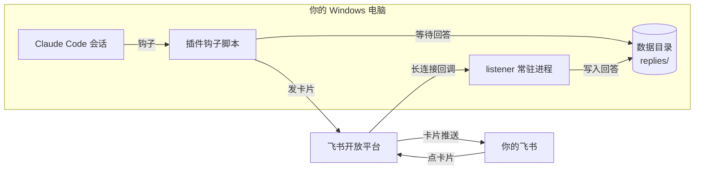

[English](README.en.md) | **中文**

# claude-feishu-remote

**在飞书上审批和回答 Claude Code 的提问，查看和控制正在跑的会话。** 人不在电脑前时，Claude Code 等你点头的事会推送到飞书，点一下卡片就能远程作答，Claude 当场接着干。你还能在飞书上看会话正在做什么、收到长任务的完成通知、叫停跑偏的一轮、随时给会话发指令。

> 适用于 **国内版飞书** 和 **Windows**。国际版 Lark（open.larksuite.com）暂不支持：代码里用的是飞书国内的接口地址。

## 能做什么

| Claude Code 里发生的事 | 飞书上收到的 | 你能做的 |
|---|---|---|
| 审批弹窗（执行命令、改文件、调用工具…） | 审批卡片，列出工具和完整参数 | 允许 / 本会话始终允许同类操作 / 拒绝 / 拒绝并写明原因 |
| 提问弹窗（AskUserQuestion） | 提问卡片：单选题是一排按钮，多题、多选用表单 | 选选项，或在“其他回答”里自己写 |
| 桌面版“下一步”框里需要你拍板的问题 | 自动改成提问卡片（见下文“工作原理”） | 同上 |
| 计划等批准、MCP 弹窗要填信息、会话出错 | 文字提醒 | 回电脑处理 |
| 你在飞书里给机器人发“会话” | 活跃会话列表：状态、项目、模型、最近活动、还在等你的卡片，每个会话下有一个输入框 | 给会话发指令；“查看”它正在做什么；“停止这一轮”；“设为当前会话” |
| 你在会话列表上点“查看” | 会话详情卡：这一轮的输入和已运行时长、正在执行的工具、最近几步、任务清单、Claude 最新的话、模型、权限模式、上下文占用 | 刷新、往前翻步骤、看最新的话全文、关注、停止 |
| 一轮运行超过 5 分钟（可调），或你关注的会话一轮结束 | 完成通知，带这一轮的最后回复；回复太长时分页 | 翻页；回复这条消息给会话发新指令 |
| 你在聊天里“回复”某个会话发来的消息或卡片 | 一条回执，写明发给了哪个会话 | 文字作为指令发给那个会话 |

- 你在电脑上先答了，飞书卡片会自动变成“已在电脑上处理”，不会重复作答。
- 卡片最多等你 12 小时，超时后作废，要回电脑处理。
- 只认你绑定的那一个飞书账号：别人点卡片、发命令都无效。
- 审批卡片会显示完整参数；参数太长被截断时不提供“允许”和“始终允许”，避免你批准没看全的操作。
- “本会话始终允许同类操作”只用 Claude Code 自己给出的建议规则，而且一律只加在这个会话里（不写进任何设置文件，会话结束就失效）。卡片上会原样写出要加的规则，例如 `Bash(npm test:*)`。
- 没做任何配置时插件什么都不做：装上但不运行安装脚本，Claude Code 的行为和没装一样。

## 工作原理



- **钩子**：插件在 Claude Code 的 `PermissionRequest`、`PreToolUse`、`Notification` 等事件上挂了钩子。需要你作答时，钩子发出飞书卡片，然后等回答。
- **listener**：一个常驻的小进程，通过飞书的长连接接收卡片点击，把答案交给正在等待的钩子。它由 Windows 计划任务在登录时启动，之后每 5 分钟检查一次，断了会自己恢复。不需要公网服务器，也不用开端口。
- **答案怎么回到 Claude**：审批的“允许 / 拒绝”和提问弹窗的答案，都通过钩子的标准返回值交还给 Claude Code，走的是它自己的答题通道，和你在电脑上点完全一样。所以 Claude 会把飞书上的回答当成你本人的输入，直接照做。
- **停止和插话怎么生效**：插件在每次工具调用前都有一个钩子（没事可做时每次约 70 毫秒，基本是启动 Python 的时间）。你点了“停止”，会话下一次调用工具时，这个钩子让这一轮在工具执行前结束；你给正在忙的会话发了指令，它在下一次调用工具时被交给 Claude。所以两者都只在工具调用的间隙生效：Claude 正在写一大段文字、或在等子代理干完活时，要等到它调用下一个工具，最晚这一轮结束。
- **为什么计划审批不能在飞书上批**：实测 Claude Code 桌面版的计划审批不接受钩子给出的决定，所以计划等批准时只发文字提醒，要回电脑批准。
- **为什么要把“下一步”框改成提问弹窗**：外部程序只能以“后台通知”的形式把“下一步”框的回答送进会话，Claude Code 会把这类通知标成“不是用户输入，不能当作批准”。这是 Claude Code 有意设计的防伪造保护，绕不开。所以插件会拦下带提问的阻塞“下一步”框，让 Claude 改用提问弹窗（AskUserQuestion）重新问一次，你在飞书上的回答就能算数。插件还会在每个会话开头告诉 Claude 这条规则。

## 使用前须知

- **只支持 Windows 10/11 和国内版飞书**，国际版 Lark 暂不支持。
- **一台电脑要用一个独立的飞书应用。** 飞书长连接不支持广播：同一个应用同时有两台电脑连着，每次点击只会随机送到其中一台。同一个人有两台电脑，也要建两个应用。
- **安全**：谁掌握了你绑定的飞书账号，谁就能在飞书上批准这台电脑上的操作，还能给正在运行的会话发指令、叫停它们。会话开着“跳过权限确认”或自动模式时，飞书指令引起的操作也不会再弹审批。只绑定你自己的账号，应用的可用范围也只加你自己。凭据只保存在本机的 `%LOCALAPPDATA%\FeishuRemote\config.json`。
- **会话内容会发到飞书**：会话详情卡、完成通知会把这一轮的输入、执行的命令、Claude 的回复发到你的飞书聊天里（只发给绑定的账号）。命令或回复里如果有密钥，也会一起出现在飞书上。运行超过 5 分钟的一轮默认会推送完成通知，不想要就给机器人发“通知 关”。完整回复在本机数据目录里保存 7 天，供翻页用。
- 你在电脑上直接说也不能让 Claude 做的事（例如替你输入密码），通过飞书说也不行。

## 安装

### 1. 准备

- Claude Code（桌面版或命令行版），并且能在终端里运行 `claude` 命令。
- Python 3.10 或更新版本：从 <https://www.python.org> 安装，勾选 “Add python.exe to PATH”。在新开的 PowerShell 里运行 `python --version` 能看到版本号就行。

### 2. 在飞书开放平台建应用

打开 <https://open.feishu.cn/app>：

1. **创建企业自建应用**，名称随意（例如“我的 Claude 助手”）。
2. **添加应用能力 → 机器人**。
3. **权限管理**，开通下面三个权限：
   - `im:message:send_as_bot`：以应用的身份发消息
   - `im:message:update`：更新消息（卡片答完后要改成“已处理”）
   - `im:message.p2p_msg:readonly`：读取用户发给机器人的单聊消息（绑定账号和接收“会话”等命令时要用）
4. **版本管理与发布 → 创建版本**，可用范围只选你自己，然后发布。企业设置要求管理员审核的话，要等审核通过。可用范围一定只放你自己：能和机器人单聊的人，都能在你绑定时发错验证码，把它作废。
5. 在 **凭证与基础信息** 里记下 App ID 和 App Secret，下一步要用。

“事件与回调”先不用配：飞书要求本机 listener 在线时才能保存长连接订阅，安装脚本会在合适的时候提示你。

### 3. 安装插件

在终端里运行：

```powershell
claude plugin marketplace add zhishouhuameiwan/claude-feishu-remote
claude plugin install feishu-remote@claude-feishu-remote
```

第一条命令一直卡着不动的话，见下文“排错”。没法访问 GitHub 的话，可以把仓库下载到本地，解压到一个长期存放的目录（插件直接在这个目录里运行，以后不要删），然后用目录路径代替 `zhishouhuameiwan/claude-feishu-remote`。

### 4. 运行安装脚本

在 PowerShell 里运行（不需要管理员权限）：

```powershell
$list = (claude plugin list --json | Out-String) | ConvertFrom-Json
$plugin = @($list) | Where-Object { $_.id -eq 'feishu-remote@claude-feishu-remote' } | Select-Object -First 1
$dir = if ($plugin.readFromFolder) { $plugin.readFromFolder } else { $plugin.installPath }
powershell -ExecutionPolicy Bypass -File (Join-Path $dir 'setup.ps1')
```

上面这几行用来找到插件的安装目录（`$dir`），后面运行 `uninstall.ps1` 和 `notify_switch.py` 时说的“插件目录”也是它。下载到本地安装的，插件目录就是 `<本地目录>\plugins\feishu-remote`。

脚本会依次完成：

1. **检查 Python**。
2. **准备 listener 环境**：在 `%LOCALAPPDATA%\FeishuRemote` 建一个独立的 Python 环境，装好 lark-oapi 并预加载。第一次预加载可能要一两分钟。
3. **填写凭据**：输入 App ID 和 App Secret，脚本会先向飞书验证一次再保存。输入的 Secret 不会显示在屏幕上，也不会出现在命令行参数里。
4. **启动 listener**：注册计划任务 “Feishu Remote Listener”，登录时自动启动，之后每 5 分钟检查一次。
5. **暂停，等你配置飞书后台的“事件与回调”**：
   - 事件配置：订阅方式选“使用长连接接收事件”，添加事件 `im.message.receive_v1`（接收消息）。
   - 回调配置：订阅方式选“使用长连接接收回调”，添加回调 `card.action.trigger`（卡片回传交互）。
   - 再创建一个版本并发布。改过权限或订阅，都要重新发布。

   配好后回到 PowerShell 按回车。
6. **绑定账号**：屏幕上会显示 8 位验证码。在飞书里找到你的机器人，打开单聊，把验证码原样发过去。看到“绑定成功”就好了，飞书里也会收到一条确认消息。

### 5. 开始用

新开一个 Claude Code 会话。已经开着的会话，包括绑定前打开的，都要重新打开。之后 Claude 等你审批或回答时，飞书上就会收到卡片。

## 日常使用

- **查看活跃会话、给会话发指令**：在飞书里给机器人发“会话”，会收到活跃会话的列表卡片。
  - 活跃会话指：工作中的、等你处理的（有审批、提问或待答卡片）、空闲但还能接收指令的（上一轮结束不到 12 小时）。其他空闲会话只在卡片底部记一个数。
  - 等你处理的排在最前，一张卡片最多列 10 个（多出的、最不急的只记个数）。每个会话列出项目、当前模型、最近活动时间、还在等你作答的飞书卡片，以及排队中的指令。
  - 每个会话下面有一个输入框：写好指令点“发送”。空闲的会话马上开始处理；正在工作的会话，指令在它下一次调用工具时送达（插话），最晚这一轮结束时送达。做完后 Claude 最后的回复会发回飞书。
  - 指令以通知的形式送进会话，Claude Code 不把它算作你本人的输入（和“下一步”框的回复一样，这道保护绕不开）。所以不需要批准的事 Claude 直接照做；提交、推送、删除这类需要拍板的事，Claude 会先发提问卡片，你在飞书上点了才算数。
  - 只能发文字指令，`/compact`、`/model` 这类斜杠命令不起作用。只有装了 1.1.0 之后新开的会话能接收指令；停止和插话要装了 1.2.0 之后新开的会话。
  - 按 Esc 打断的一轮、因接口出错结束的一轮之后，会话要等下一轮结束才会再收指令（期间发的指令先排队）。在飞书上“停止”的一轮不受这个限制：停下后马上能接着收指令。排队超过 12 小时没送出的指令会作废。
  - 列表数据来自 Claude Code 自带的 `claude agents --json`，所以 listener 要能运行 `claude` 命令。发“帮助”可以看全部命令。
- **看会话在干什么**：会话列表上点“查看”，收到会话详情卡（见上表）。点“刷新”更新，点“更早的步骤”往前翻。点“关注”之后，这个会话每一轮结束都会推送最后的回复；没关注的会话，一轮运行超过 5 分钟才推送。给机器人发“通知 10”改成 10 分钟，发“通知 关”关闭，发“通知”查看当前设置。回复太长时卡片分页显示，点“下一页”往后看。
- **停止正在跑的一轮**：在会话列表或详情卡上点“停止这一轮”。它在下一次调用工具时停下，停下后飞书上会收到“已停下”的通知。它正在等审批或回答时，会替你答“停止”，并让它结束这一轮。只停这一轮：之后你在电脑上或飞书上发的新指令照常处理。会话已经空闲时点“停止”不起作用；点了之后 30 分钟内它都没有调用工具、这一轮也没结束，这次停止作废。
- **直接在聊天里给会话发指令**：
  - “回复”某个会话发来的任意消息或卡片（审批卡、完成通知、详情卡、回执都可以），回复的文字就发给那个会话。回复里写“会话”这类命令词，也当作给会话的指令。
  - 或者在会话列表、详情卡上点“设为当前会话”，之后直接在聊天里打的字都发给它。30 分钟不用会自动取消，每次发出都会回一条回执写明发给了哪个会话。“会话”“帮助”“通知”这几个命令词照常当命令处理。
- **暂时不想收提醒**：运行 `python <插件目录>\scripts\notify_switch.py off`，恢复时改成 `on`。关掉提醒后，你主动发的命令照样有回复。
- **换一个飞书账号接收**：运行 `setup.ps1 -Rebind`。
- **换一个飞书应用**：运行 `setup.ps1 -Reconfigure`。换应用后原来的绑定会自动清除，需要重新绑定。
- 一台电脑只装一份插件。不要再用 `--plugin-dir` 额外加载一份副本，两份同时存在会让 listener 来回重启。

## 更新

```powershell
claude plugin marketplace update claude-feishu-remote
claude plugin update feishu-remote@claude-feishu-remote
```

然后按“安装”第 4 步的方法重新运行一次 `setup.ps1`：它会更新 lark-oapi，并用新代码重启 listener，已保存的凭据和绑定都会保留。最后重开 Claude Code 会话。

本地目录安装的：把新版本覆盖解压到原来的目录，重新运行 `setup.ps1`，再重开会话。

## 卸载

```powershell
powershell -ExecutionPolicy Bypass -File <插件目录>\uninstall.ps1
claude plugin uninstall feishu-remote@claude-feishu-remote
claude plugin marketplace remove claude-feishu-remote
```

`uninstall.ps1` 会删除计划任务、停止 listener，并删除数据目录（凭据、绑定信息、日志）。加 `-KeepData` 则保留数据目录，以后重装就不用再填。

## 排错

| 现象 | 先看什么 |
|---|---|
| 飞书上点卡片，提示“回调服务当前未在线” | listener 没在运行。打开“任务计划程序”手动运行 “Feishu Remote Listener”，或者重新运行 `setup.ps1`。日志在 `%LOCALAPPDATA%\FeishuRemote\listener.log`。 |
| 完全收不到卡片 | 看 `%LOCALAPPDATA%\FeishuRemote\hooks.log`。如果有 `WinError 10061`，通常是系统代理开着但代理程序没在运行。 |
| 绑定时发了验证码没反应 | 检查三点：应用开通了 `im:message.p2p_msg:readonly`；事件订阅里有 `im.message.receive_v1`；改完已经重新发布版本。验证码 30 分钟内有效，连续发错 5 次会作废，重新运行 `setup.ps1` 即可。 |
| 发“会话”后回复“找不到 claude 命令” | listener 找不到 `claude`。先在新开的 PowerShell 里确认 `claude --version` 能运行，再重新运行 `setup.ps1`（会重启 listener）；还不行就注销后重新登录 Windows。 |
| 安装脚本提示 listener 2 分钟内没有启动 | 第一次启动时，杀毒软件扫描新文件可能很慢。稍等一会儿再运行一次 `setup.ps1`。 |
| 两台电脑用了同一个应用 | 两边会互相抢点击，必须给每台电脑各建一个应用。 |
| `claude plugin marketplace add zhishouhuameiwan/claude-feishu-remote` 一直卡着不动，或者重试时报 `EBUSY` | 这种简写会通过 SSH 克隆仓库，有的网络环境下会卡住。先按 Ctrl+C 退出，在任务管理器里结束卡住的 `git.exe` 和 `ssh.exe`，再删掉报错里提到的临时目录（`%USERPROFILE%\.claude\plugins\marketplaces\` 下以 `..clone` 结尾的那个），然后改用完整的 HTTPS 地址添加：`claude plugin marketplace add https://github.com/zhishouhuameiwan/claude-feishu-remote.git`。 |

## 开发

```
.claude-plugin/marketplace.json      插件市场清单
plugins/feishu-remote/
  .claude-plugin/plugin.json         插件清单
  hooks/hooks.json                   钩子注册
  scripts/                           钩子、listener、卡片、绑定等脚本（钩子只用 Python 标准库）
  setup.ps1 / uninstall.ps1          安装与卸载（兼容 Windows PowerShell 5.1）
  tests/                             离线测试
```

离线测试不会向飞书发送任何内容，每套测试都在自己的临时数据目录里运行，不会碰到正在运行的 listener 和真实配置：

```powershell
# 需要一个装了 lark-oapi 的 Python；运行过 setup.ps1 的话会自动使用它建的环境
$env:FEISHU_TEST_PYTHON = 'C:\path\to\python-with-lark-oapi.exe'
powershell -ExecutionPolicy Bypass -File plugins\feishu-remote\tests\run_tests.ps1
```

## 许可证

[MIT](LICENSE)
